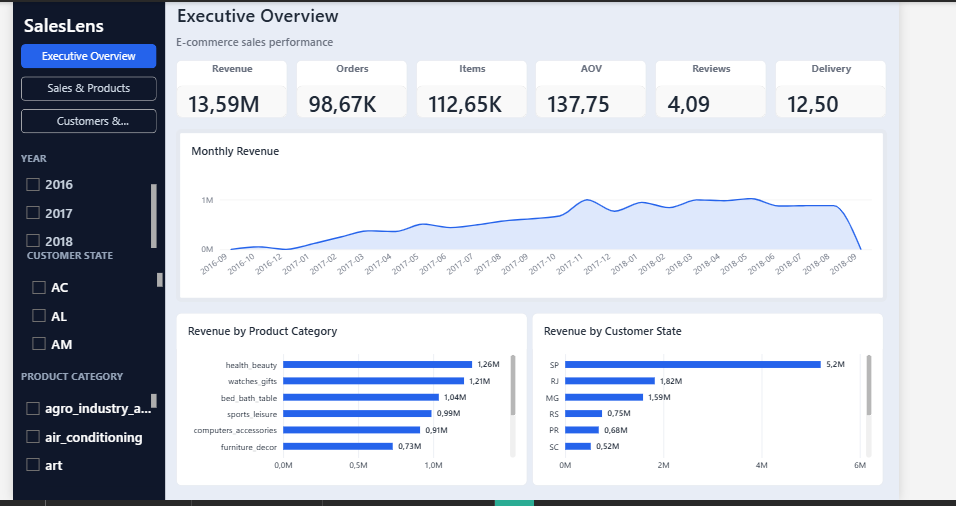
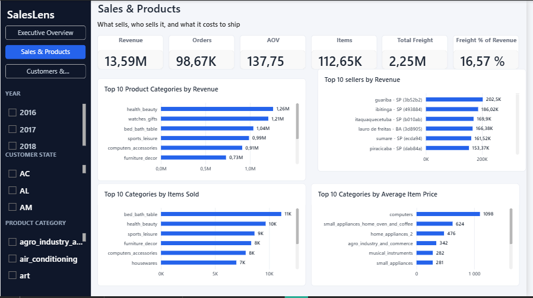
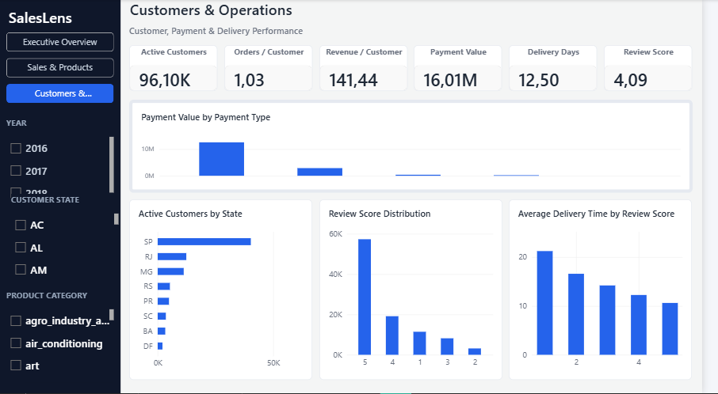
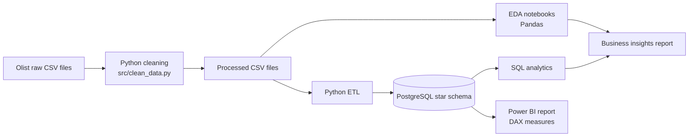
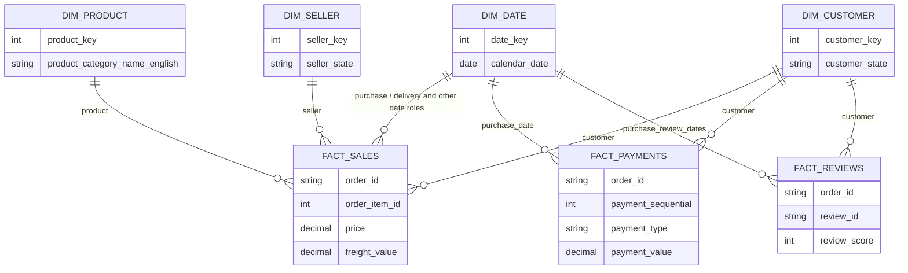

<div align="center">

# SalesLens

**Turning e-commerce transactions into clear sales, customer, payment and delivery insights.**

An end-to-end Data Analytics and Business Intelligence portfolio project built on the public Olist Brazilian E-Commerce dataset.

[](https://www.python.org/)
[](https://pandas.pydata.org/)
[](https://www.postgresql.org/)
[](https://www.docker.com/)
[](sql/02_analytics.sql)
[](dashboard/SalesLens.pbix)

</div>

---

## Contents

- [Project Overview](#project-overview)
- [Power BI Dashboard](#power-bi-dashboard)
- [Technical Architecture](#technical-architecture)
- [Technology Stack](#technology-stack)
- [Data Model](#data-model)
- [Key Business Insights](#key-business-insights)
- [KPIs and Methodology](#kpis-and-methodology)
- [Repository Structure](#repository-structure)
- [Setup and Execution](#setup-and-execution)
- [Limitations and Next Steps](#limitations-and-next-steps)
- [Contact](#contact)

## Project Overview

### Business question

How can an e-commerce marketplace understand its sales mix and customer activity while keeping product sales, shipping charges, payments and service outcomes analytically distinct?

### Objectives

- Explore and clean the source data with Python and Pandas.
- Describe orders, product categories, customer locations, payment methods, reviews and delivery times.
- Design a dimensional PostgreSQL model that preserves the different grains of sales, payments and reviews.
- Load the model through a reproducible Python ETL and provide reusable SQL analytics.
- Present decision-oriented KPIs in a Power BI report and summarize the findings in a business insights report.

### Dataset and scope

The project uses the public **Brazilian E-Commerce Public Dataset by Olist**. The documented source contains 99,441 order records, 112,650 order-item rows, 103,886 payment allocations, 99,224 review records, 32,951 products, 3,095 sellers and 96,096 unique customers. The analysis covers purchase dates from September 2016 to October 2018; the first and last months are incomplete.

The analysis focuses on product revenue and freight, category and seller activity, customer state, payment mix, delivery time and review scores. It is descriptive: it identifies patterns to investigate and does not establish causation or market potential.

## Power BI Dashboard

The Power BI report contains three pages. The `.pbix` file is available at [`dashboard/SalesLens.pbix`](dashboard/SalesLens.pbix), and the project screenshots below are stored in `dashboard/screenshots/`. The values in the captures are shown as rendered; the underlying DAX formulas and filter context still need verification in Power BI Desktop.

### Executive Overview

Marketplace overview with monthly revenue, category revenue and revenue by customer state. The screenshot cards display **BRL 13.59M** revenue, **98.67K** orders, **112.65K** items, **BRL 137.75** AOV, **4.09** reviews and **12.50 days** delivery.



*Figure 1. Executive Overview: headline sales and service KPIs, monthly revenue, category revenue and customer-state revenue.*

### Sales & Products

Sales and shipping KPIs with category revenue and volume, seller revenue and average item price by category. The screenshot cards display revenue **BRL 13.59M**, **98.67K** orders, AOV **BRL 137.75**, **112.65K** items, freight **BRL 2.25M** and freight/revenue **16.57%**.



*Figure 2. Sales & Products: category revenue and item volume, seller revenue, average item price, and freight alongside product revenue.*

### Customers & Operations

Customer, payment, review and delivery views, including payment value by payment type and delivery time by review score. The screenshot cards display **96.10K** active customers, **1.03** orders per customer, **BRL 141.44** revenue per customer, **BRL 16.01M** payment value, **12.50 days** delivery and review score **4.09**.



*Figure 3. Customers & Operations: customer and payment KPIs, active customers by state, review distribution and delivery time by review score.*

> Values are reproduced from the screenshots and may be rounded. Matching a CSV-derived value does not verify a DAX formula. Check each KPI's definition and filter context in Power BI before comparing it with a separately scoped SQL or EDA result.

## Technical Architecture



The pipeline stages correspond to `src/clean_data.py`, `notebooks/03_eda.ipynb`, `src/etl/`, `sql/01_create_schema.sql`, `sql/02_analytics.sql` and `dashboard/SalesLens.pbix`. The raw and processed CSV files are excluded from version control by `.gitignore`; they are present in some local working copies but are not included in a fresh GitHub clone. Run cleaning after placing the original Olist CSV files in `data/raw/`.

## Technology Stack

| Technology | Role in SalesLens |
|---|---|
| Python | Reproducible cleaning, transformations and ETL orchestration. |
| Pandas | CSV processing, validation and exploratory analysis. |
| PostgreSQL | Relational storage for the dimensional model and analytical queries. |
| Docker Compose | Local PostgreSQL service and persistent database volume. |
| SQL | Schema definition and grain-aware KPI queries. |
| Power BI and DAX | Interactive report with measures and filters across three report pages. |
| Jupyter | Exploration and documented EDA workflows. |

## Data Model

The model separates three business processes at their natural grains. `order_id` is retained in each fact for order-level aggregation; facts should not be joined directly to one another without first aggregating to a common grain.



- **`fact_sales`**: one row per order item; stores product `price` and `freight_value` separately.
- **`fact_payments`**: one row per payment allocation; stores payment type, installment count and `payment_value`.
- **`fact_reviews`**: one row per review for an order; preserves multiple reviews rather than collapsing them during ETL.
- **Dimensions**: `dim_date`, `dim_customer`, `dim_product` and `dim_seller`. Payment type remains an attribute of `fact_payments`; there is no payment-type dimension in the implemented schema.

The schema is defined in [`sql/01_create_schema.sql`](sql/01_create_schema.sql). Each date dimension role is connected to the relevant date key. Use distinct order counts and avoid fact-to-fact joins that multiply item, payment or review rows.

## Key Business Insights

These are descriptive findings from [`docs/business_insights.md`](docs/business_insights.md), not causal conclusions.

| Finding | Evidence | Practical reading |
|---|---|---|
| Product revenue and freight are distinct measures. | Product revenue: **BRL 13.59M**; freight: **BRL 2.25M**. | Report shipping separately; neither amount is profit. |
| Category leaders depend on the measure. | `health_beauty`: **BRL 1.26M** product revenue; `bed_bath_table`: **11,115** items sold. | Compare item volume and revenue together. |
| November 2017 is the highest observed revenue month. | **BRL 1.01M** across **7,451** itemized orders. | Investigate the period; the short, edge-incomplete series does not establish seasonality. |
| Observed sales are concentrated in SP. | **41,375** itemized orders and **BRL 5.20M** product revenue. | This is current activity, not a measure of total market potential. |
| Credit card is the largest payment type in the observed records. | **76,505** distinct orders; **BRL 12.54M** in payment allocations. | Payment allocations and payment value are not product revenue. |
| Delivery and review score move together in the EDA. | One-star reviews: **21.34** mean delivery days; five-star: **10.68**. | Association only; delivery time alone is not shown to cause lower ratings. |

The report also recommends investigating delayed, low-score orders and reconciling payment versus sales measures. Those are follow-up actions, not claims that a particular intervention will improve an outcome.

## KPIs and Methodology

The SQL query definitions are in [`sql/02_analytics.sql`](sql/02_analytics.sql). The PBIX report metadata binds visuals to measures including Total Revenue, Total Orders, Total Items Sold, Average Order Value, Total Freight, Freight % of Revenue, Total Payment Value, Average Review Score, Average Delivery Days, Average Item Price, Active Customers, Total Reviews, Average Delivery Days by Review, Revenue per Customer and Orders per Customer. The DAX expressions, model relationships and full filter behavior could not be read with the available local tools. Dashboard values therefore do not verify each formula or denominator. SQL definitions below are independently documented in the SQL comments.

Reproduce the read-only CSV calculations and integrity checks from the repository root with `python scripts/audit_metrics.py`. This script reads `data/processed/` only; it does not connect to PostgreSQL or inspect DAX.

| KPI | Definition and scope |
|---|---|
| Product revenue | `SUM(fact_sales.price)`, excluding freight. Item grain; recalculated from processed CSVs: **BRL 13,591,643.70**. |
| Freight | `SUM(fact_sales.freight_value)`, kept separate from product revenue; recalculated from processed CSVs: **BRL 2,251,909.54**. |
| Freight % of product revenue | CSV check: freight / product revenue = **16.5683%**, which rounds to the **16.57%** shown in the preview. The DAX expression and filter context remain unverified. |
| Average order value | Product revenue divided by distinct orders with at least one item. CSV-recalculated value **BRL 137.75**; denominator is **98,666** itemized orders, not all 99,441 source order records. |
| Orders | SQL: `COUNT(DISTINCT order_id)` in `fact_sales`; CSV-recalculated count **98,666**. The source has **99,441** orders, including 775 without an item line. |
| Items sold | Count of order-item rows (`COUNT(*)` in `fact_sales`), not distinct orders. CSV-recalculated total **112,650**. |
| Payment value | `SUM(fact_payments.payment_value)` at payment-allocation grain; CSV-recalculated total **BRL 16,008,872.12**, matching ETL reconciliation. Not product revenue and not safely additive after joining to item rows. |
| Delivery days | SQL query: mean calendar-date difference, one row per itemized order with both dates. EDA: elapsed timestamp difference across 96,476 orders with both timestamps (mean **12.56 days**). Recalculation from the processed CSVs reproduced 96,476 orders for both populations and **12.50 days** using SQL's calendar-date method. The displayed Power BI value matches that rounded result, but its DAX formula is not available for inspection. |
| Review score | Arithmetic mean of individual review rows: **4.09** over **99,224** records, recalculated from CSVs. EDA delivery association averages review scores per order first. Multiple reviews can exist per order, so the aggregation grain matters. |
| Average delivery days by review score | The EDA calculates delivery once per order and averages order-level mean review scores; it reports **21.34 days** at score 1 and **10.68 days** at score 5. SQL analytics instead retains individual review rows. The Power BI DAX measure and its review grain are unverified. |
| Active customers | Dashboard screenshot: **96.10K**, consistent with **96,096** distinct `customer_unique_id` values in the processed customer records. The DAX column, filter context and active-customer definition are not verified. |
| Other PBIX measures | `Total Reviews` (source count: **99,224**) and `Average Item Price` are referenced by report visuals. Their DAX formulas, denominators and filter contexts are not exposed in the repository files. |
| Revenue per customer / orders per customer | The previews display **BRL 141.44** and **1.03**. Product revenue divided by 96,096 unique customer IDs calculates to **BRL 141.44**; both 99,441 source orders and 98,666 itemized orders divided by 96,096 round to **1.03**. These are consistency checks, not confirmation of the DAX denominators or filter context. |

The delivery average difference is explained by precision: on the processed CSVs, the EDA timestamp calculation and SQL-style calendar-date calculation both include 96,476 delivered orders, while date-only keys yield 12.50 rather than 12.56 days. This is a CSV reproduction of the SQL logic, not a saved query result from PostgreSQL. The DAX expression behind the Power BI card still requires inspection.

To verify a Power BI KPI, open `dashboard/SalesLens.pbix` in Power BI Desktop, switch to **Model view**, select the named measure in the Data/Model pane, and inspect its DAX in the formula bar (enable it from **View > Formula bar** if hidden). Record the expression, home table and format. Then check the report page and slicer filters under which its value is shown. For `Average Delivery Days`, confirm whether it uses calendar-date keys or source timestamps and whether it averages one row per order. For `Revenue per Customer`, check which customer identifier and date/category filters define the denominator. For `Orders per Customer`, check whether the numerator counts all order records or only orders with item rows. The preview values are not enough to establish these definitions.

## Repository Structure

| Path | Purpose |
|---|---|
| `data/raw/` | Local location for original Olist CSV files; excluded from version control. |
| `data/processed/` | Generated cleaned CSV files; excluded from version control. |
| `notebooks/` | Data exploration, cleaning and EDA notebooks, including an executed exploration notebook. |
| `src/clean_data.py` | Cleaning and processed CSV export. |
| `src/etl/` | ETL configuration, extraction, transformation and PostgreSQL loading. |
| `scripts/audit_metrics.py` | Read-only CSV KPI reconciliation and grain/integrity checks. |
| `sql/01_create_schema.sql` | PostgreSQL star schema DDL. |
| `sql/02_analytics.sql` | Read-only analytical KPI queries. |
| `docker/compose.yml` | Local PostgreSQL container configuration. |
| `dashboard/SalesLens.pbix` | Power BI report. |
| `dashboard/screenshots/` | Executive Overview, Sales & Products, and Customers & Operations PNG captures embedded above. |
| `docs/` | Setup, cleaning, star schema, ETL and business insight documentation. |
| `tests/` | ETL transformation tests and environment check. |
| `requirements.txt` | Python project dependencies. |
| `SalesLens.json` | Power BI report theme. |

## Setup and Execution

Commands below are written for PowerShell from the repository root. The Olist CSVs must be obtained separately and placed in `data/raw/` using their source filenames; the data files are not included here. Do not commit local credentials or source data.

### 1. Configure Python and local credentials

```powershell
py -m venv .venv
.\.venv\Scripts\Activate.ps1
python -m pip install -r requirements.txt
if (-not (Test-Path .env)) { Copy-Item .env.example .env }
```

Edit `.env` locally and replace the placeholder password. `.env` is ignored by Git; keep it private.

### 2. Clean the source data

After adding the Olist source CSV files to `data/raw/`:

```powershell
python -m src.clean_data
```

This generates the cleaned CSV inputs under `data/processed/`.

### 3. Start PostgreSQL and create the schema

```powershell
docker compose --env-file .env -f docker/compose.yml up -d
docker compose --env-file .env -f docker/compose.yml ps
```

Wait until the PostgreSQL service reports healthy. Then create the tables from the checked-in DDL:

```powershell
Get-Content -Raw sql/01_create_schema.sql | docker exec -i saleslens-postgres psql -U saleslens_user -d saleslens
```

### 4. Load the star schema

```powershell
python -m src.etl.run_etl
```

The ETL reads `data/processed/`, loads the dimensions and facts in a transaction, and validates the load. PostgreSQL must be running, the schema must exist, and the processed source files must be present first.

### 5. Run the tests

```powershell
python -m pytest
```

### 6. Open the report

Open `dashboard/SalesLens.pbix` in Power BI Desktop. The three report page captures are already embedded in the [Power BI Dashboard](#power-bi-dashboard) section.

## Limitations and Next Steps

- **No product cost data:** profit and a true product margin cannot be calculated. Product revenue is not profitability.
- **Incomplete period edges:** the first and last purchase months are partial, and the roughly two-year window is insufficient to establish recurring seasonality.
- **Missing operational dates:** delivery-time analysis excludes orders without a customer-delivery timestamp; undelivered or incomplete orders need separate treatment.
- **Different fact grains:** sales items, payment allocations and review rows must be analyzed separately or aggregated to order level before comparison.
- **Delivery and satisfaction are associated, not causal:** product quality, expectations, customer service and other factors may also influence reviews.
- **No executed SQL results committed:** documented EDA and ETL totals are available, but not a saved output for every SQL query.

Realistic next steps include adding validated product cost and returns data, capturing SQL query outputs in reconciliation documentation, documenting DAX definitions and filter behavior, and defining a defensible postal-code matching rule before analyzing shipping distance.


